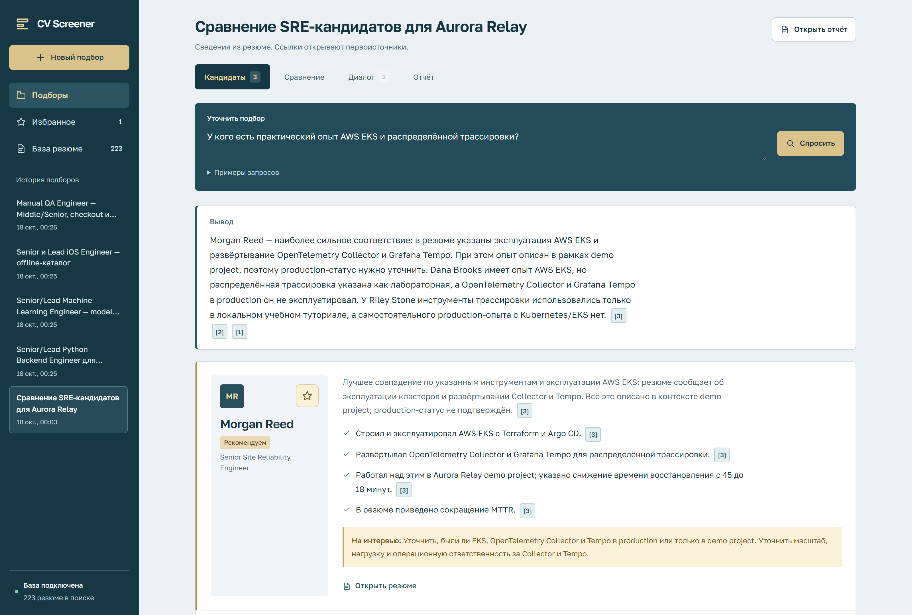
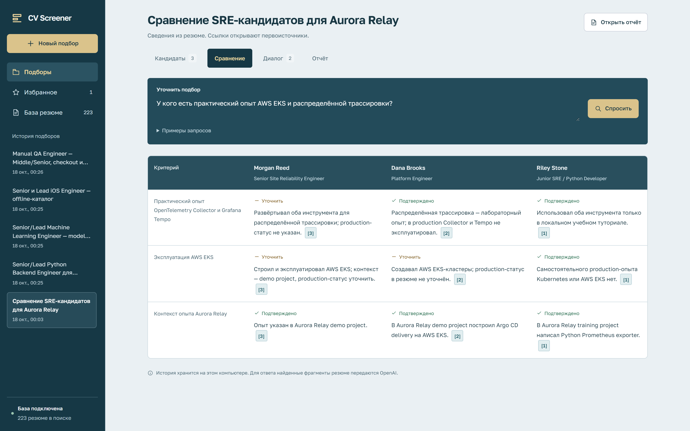
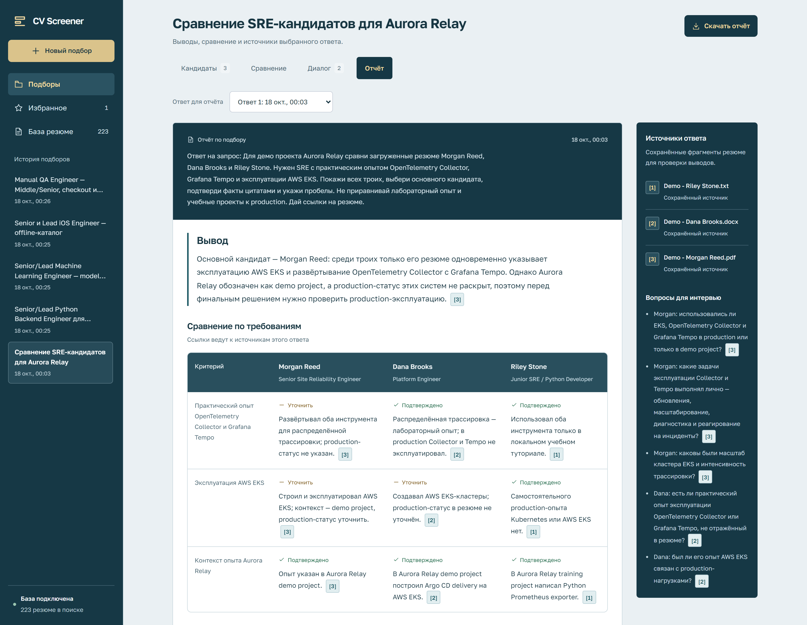
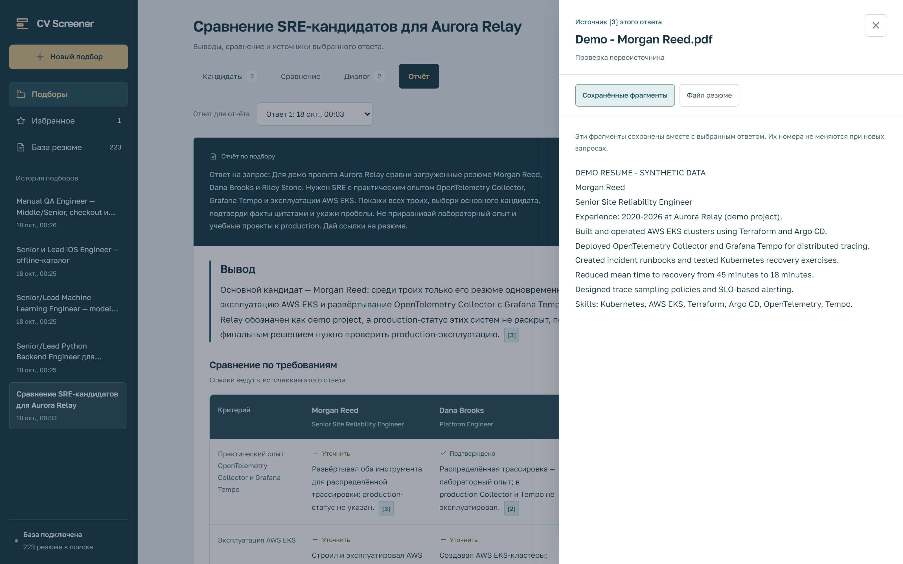
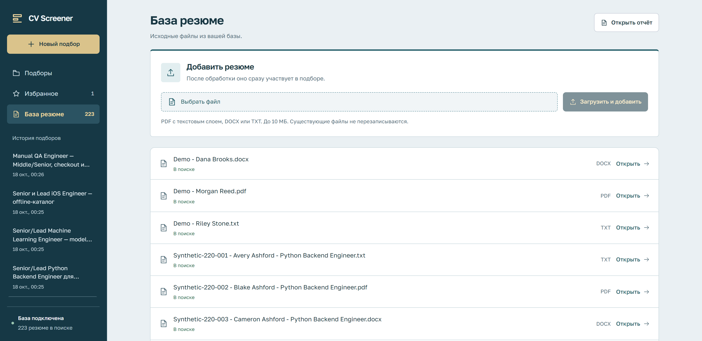
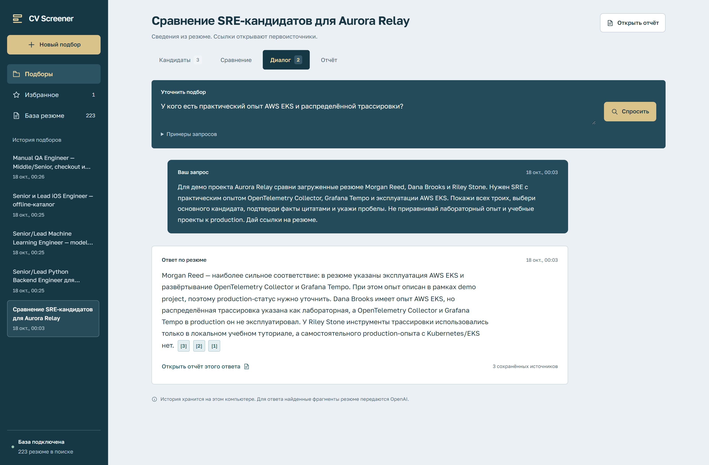
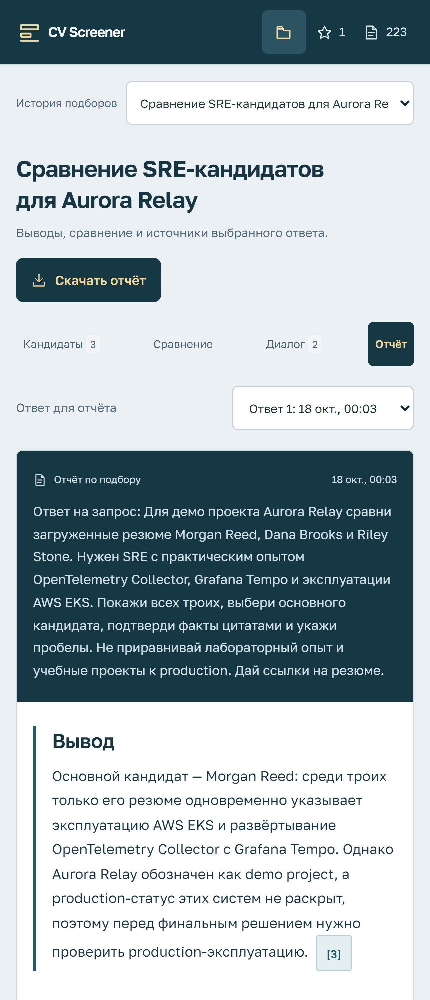

# CV Screener

Локальное приложение для поиска и сравнения кандидатов по собственной базе резюме. Помогает собрать короткий список, проверить основания рекомендации и подготовить отчёт для обсуждения с нанимающим руководителем.

**React → FastAPI → MiniLM / Qdrant → OpenAI**

Интерфейс, оригиналы документов, поисковый индекс и история работают на вашем компьютере. Для генерации ответа найденные тексты резюме и контекст диалога передаются в OpenAI. Приложение не является полностью автономным или офлайн-сервисом.

## Интерфейс

Подбор кандидатов с рекомендацией, подтверждёнными фактами и ссылками на резюме. Скриншоты сняты в отдельном запуске приложения с базой из 223 явно вымышленных резюме и сохранёнными ответами OpenAI.

[](docs/screenshots/01-candidates.png)

<details>
<summary>Сравнение, отчёт, источники, загрузка резюме, история и мобильный интерфейс</summary>

### Сравнение кандидатов

Единые критерии и факты с указанием источника для каждого кандидата.



### Отчёт по подбору

Рекомендация, сравнительная таблица, вопросы для интервью и панель источников. Отчёт можно скачать в Markdown.



### Проверка источника

Ссылка открывает фрагмент резюме, сохранённый вместе с конкретным ответом.



### База резюме

Загрузка PDF, DOCX и TXT с автоматической индексацией; документы, участвующие в поиске, отмечены в списке.



### История диалога

Сохранённые запрос, ответ и ссылки на источники; история подборов доступна в общей навигации.



### Мобильный интерфейс

<a href="docs/screenshots/07-mobile.png"></a>

</details>

[Все изображения и размеры оригиналов](docs/screenshots/README.md). PNG сняты в масштабе 2× на компьютере и 3× для мобильного экрана; откройте изображение, чтобы рассмотреть текст в полном разрешении.

## Содержание

- [Интерфейс](#интерфейс)
- [Возможности](#возможности)
- [Как это работает](#как-это-работает)
- [Технологии и требования](#технологии-и-требования)
- [Быстрый старт](#быстрый-старт)
- [Настройки](#настройки)
- [Работа с резюме](#работа-с-резюме)
- [Пример демо-сценария](#пример-демо-сценария)
- [История, источники и отчёты](#история-источники-и-отчёты)
- [API](#api)
- [Разработка](#разработка)
- [Тестирование](#тестирование)
- [Хранение данных и резервные копии](#хранение-данных-и-резервные-копии)
- [Ограничения](#ограничения)
- [Решение проблем](#решение-проблем)
- [Подготовка к публикации](#подготовка-к-публикации)
- [Лицензия](#лицензия)

## Возможности

- **Поиск на естественном языке.** Опишите вакансию, обязательные навыки и ограничения или назовите конкретные файлы резюме.
- **Уточнения в одном диалоге.** Сужайте подбор и задавайте дополнительные вопросы с сохранением сведений о ранее обсуждавшихся кандидатах.
- **Карточки кандидатов.** Роль, краткое резюме опыта, подтверждающие цитаты и сведения, которые нужно уточнить.
- **Сравнение.** Единые критерии, подтверждённые факты и пробелы в данных для нескольких кандидатов.
- **Проверяемые источники.** Ссылки открывают сохранённый контекст конкретного ответа; отдельно доступен извлечённый текст текущего файла.
- **Отчёт.** Рекомендация, сравнение и вопросы для интервью; скачивание в Markdown с сохранёнными источниками.
- **История и избранное.** Диалоги и снимки источников сохраняются в SQLite и переживают перезапуск приложения.
- **Пополнение базы.** Загрузка PDF, DOCX и TXT через интерфейс с автоматической индексацией и статусами обработки.
- **Единый интерфейс «Пульт».** Общая навигация и оформление всех разделов с адаптацией под мобильные экраны.

Результаты помогают проверить соответствие резюме запросу. Отсутствие навыка в тексте означает недостаток подтверждения, а не доказанное отсутствие навыка у человека. Решение о найме остаётся за пользователем.

## Как это работает

```mermaid
flowchart LR
    Files["PDF / DOCX / TXT"] --> Extract["Извлечение текста и разбиение"]
    Extract --> Embed["Локальная модель MiniLM"]
    Embed --> Qdrant["Qdrant"]
    UI["React: запрос пользователя"] --> API["FastAPI"]
    API --> Search["Поиск и BM25-ранжирование"]
    Qdrant --> Search
    Search --> LLM["OpenAI: структурированный ответ"]
    LLM --> Validate["Проверка структуры, ссылок и цитат"]
    Validate --> History["SQLite: история и источники"]
    History --> UI
```



1. Текст извлекается локально; MiniLM формирует векторы для частей документов. Qdrant хранит векторы, текст и метаданные.
2. Запрос проходит векторный поиск и дополнительное BM25-ранжирование. Из пула до 100 фрагментов выбирается до 25 разных резюме, затем загружаются их индексированные части.
3. Полные имена файлов, явно указанные в запросе, получают приоритет перед семантическим ранжированием. При уточнениях сохраняются ранее процитированные резюме; ссылки из прошлых ответов сопоставляются с текущими источниками по имени файла.
4. OpenAI получает запрос, контекст разговора и найденные тексты. Для React-интерфейса используется Chat Completions со Structured Outputs.
5. Сервер проверяет структуру, номера источников, имена и наличие дословных цитат. Если проверка не пройдена, выполняется одна попытка исправления. После повторной ошибки ответ не записывается в историю.
6. Корректный ответ и снимки источников сохраняются вместе. Карточки, сравнение и отчёт используют эти данные.

Проверка дословной цитаты не доказывает правильность каждого вывода модели. Смысл рекомендации нужно сверять с источником, особенно при сопоставлении периодов работы, разных версий резюме и числовых достижений.

## Технологии и требования

| Компонент | Используется в проекте |
| --- | --- |
| Основной интерфейс | React 19.3.1, Vite 8.3.4, локальный шрифт Golos Text |
| API | FastAPI 0.143.2, Uvicorn 0.54.0, Pydantic |
| Генерация ответов | OpenAI SDK 2.54.0; конфигурация по умолчанию `gpt-6-luna`, reasoning `medium` |
| Эмбеддинги | `sentence-transformers/multi-qa-MiniLM-L6-cos-v1`, Sentence Transformers, CPU PyTorch |
| Поисковая база | Qdrant 1.17.1 в Docker, BM25 для дополнительного ранжирования |
| Чтение документов | pypdf, python-docx; TXT читается средствами Python |
| История | SQLite |

Точные Python-зависимости зафиксированы в [requirements.txt](requirements.txt), JavaScript-зависимости — в [frontend/package-lock.json](frontend/package-lock.json).

Для описанного ниже запуска нужны:

- Python **3.12** и установленный `uv`;
- Node.js **22.12+** и npm;
- запущенный Docker с Docker Compose; на Windows — Docker Desktop с Linux-контейнерами;
- PowerShell **7+** для приведённых команд;
- ключ OpenAI API с доступом к настроенной модели;
- интернет для установки пакетов, первого скачивания MiniLM и запросов OpenAI.

Проверенное локальное окружение — Windows x64, Python 3.12, CPU. GPU не требуется. Установка на Linux/macOS отдельно не подтверждена; закреплённый пакет `torch==2.13.0+cpu` требует платформу с соответствующим CPU wheel.

## Быстрый старт

```powershell
git clone https://github.com/gushinets/cv-screener.git
cd cv-screener
```

Все команды выполняются из корня клонированного репозитория. В публичную поставку не входят реальные резюме, ключи и готовый поисковый индекс.

### 1. Установите зависимости

```powershell
uv venv --python 3.12 .venv
uv pip install --python .venv\Scripts\python.exe --torch-backend cpu -r requirements.txt
npm --prefix frontend ci
npm --prefix frontend run build
```

Активация виртуального окружения не нужна: далее интерпретатор вызывается явно.

### 2. Создайте локальные настройки

```powershell
if (-not (Test-Path src\aiconfig.json)) {
    Copy-Item src\aiconfig.example.json src\aiconfig.json
}
$env:OPENAI_API_KEY = Read-Host 'OpenAI API key' -MaskInput
$env:PYTHONUTF8 = '1'
```

Шаблон [src/aiconfig.example.json](src/aiconfig.example.json) содержит структуру настроек без ключа. `src/aiconfig.json` исключён из Git. Команда выше сохраняет существующий локальный конфиг.

Переменная с ключом действует в текущем терминале и запускаемых из него процессах. При запуске приложения из другого терминала задайте её там повторно. Файл `.env` автоматически **не загружается**.

### 3. Поднимите Qdrant

```powershell
docker compose up -d
docker compose ps
```

Compose запускает только Qdrant; Python API и React не контейнеризированы. База слушает `127.0.0.1:6333`, данные сохраняются в Docker-томе `cv-screener_qdrant_data`.

### 4. Запустите приложение

```powershell
.\.venv\Scripts\python.exe src\server.py
```

Откройте **[http://127.0.0.1:7860/](http://127.0.0.1:7860/)**. На первом запуске MiniLM скачивается в `src/models`, поэтому старт может занять больше времени.

Откройте «Базу резюме», загрузите документ и дождитесь статуса **«В поиске»**. После этого отправьте запрос на подбор.

Если документы уже помещены в `data`, можно предварительно выполнить командный импорт:

```powershell
.\.venv\Scripts\python.exe src\import_resumes.py
```

Импорт извлекает текст и строит эмбеддинги локально, без вызовов OpenAI. При пустой папке импортёр сообщит об отсутствии документов; для первого запуска через интерфейс импортёр не нужен.

### Остановка и повторный запуск

Нажмите `Ctrl+C` в терминале приложения. Чтобы остановить базу с сохранением данных:

```powershell
docker compose stop
```

Для следующего запуска повторите `docker compose up -d`, задайте ключ в текущем терминале и запустите `src/server.py`. Пересборка React и повторная индексация неизменённых документов не требуются.

## Настройки

Конфиг читается из `src/aiconfig.json` при запуске. Верхние поля `chat`, `embedding` и `store` выбирают одноимённые разделы с параметрами.

| Настройка | Значение шаблона / назначение |
| --- | --- |
| `chat` | `openai-gpt-6-luna` — активный раздел генерации |
| `openai-gpt-6-luna.model` | `gpt-6-luna` |
| `openai-gpt-6-luna.reasoning_effort` | `medium` |
| `openai-gpt-6-luna.genkey` | Пустая строка; предпочтительно передать ключ через окружение |
| `embedding` | `miniLM` |
| `miniLM.model` | `sentence-transformers/multi-qa-MiniLM-L6-cos-v1` |
| `miniLM.tokens` | `512` — настройка модели эмбеддингов |
| `store` | `qdrant` |
| `qdrant.host`, `qdrant.port` | `localhost`, `6333` |
| `qdrant.collection` | `resumes` |
| `qdrant.similarity` | `Cosine` |
| `preprocessor.chunk_size` | `512`, длина определяется токенизатором эмбеддингов |
| `preprocessor.chunk_overlap` | `0` |

Переменные окружения:

| Переменная | Поведение |
| --- | --- |
| `OPENAI_API_KEY` | Переопределяет `genkey` активного раздела |
| `OPENAI_MODEL` | Переопределяет имя модели из конфига |
| `PYTHONUTF8=1` | Включает UTF-8 для Python, полезно для русских текстов и логов на Windows |
| `HF_HUB_OFFLINE=1` | Необязательный режим использования уже скачанного кеша Hugging Face; не задавайте до первого скачивания |

После смены настроек перезапустите приложение. Параметр reasoning задаётся в JSON; отдельной переменной окружения для него нет. Для моделей с префиксом `gpt-5`/`gpt-6` код передаёт `reasoning_effort` без `temperature`; для остальных используется `temperature` из конфига или `1.0`.

Выбранная модель должна быть доступна вашему API-проекту и поддерживать Structured Outputs в Chat Completions. Наличие старых провайдеров в `src/providers/chat` не означает, что основной React API умеет переключаться на локальную LLM: в нём используется клиент OpenAI.

Поля `modelResponseTokens` и `modelTotalTokens` оставлены для совместимости с прежними компонентами. Они **не задают денежный лимит** и не ограничивают контекст текущего React API. В основном приложении нет встроенного счётчика бюджета или общего потолка расходов. Запрос может включать повторную генерацию после ошибки проверки; стоимость оплачивается в вашем OpenAI API-проекте.

При смене модели эмбеддингов используйте отдельную коллекцию и заново проиндексируйте документы. Нельзя смешивать в одной коллекции векторы от разных моделей, даже если их размер совпадает. Проверка размерности при запуске не проверяет происхождение векторов.

## Работа с резюме

### Поддерживаемые файлы

| Формат | Что читается | Ограничения |
| --- | --- | --- |
| PDF | Текстовый слой страниц | Без OCR; защищённые паролем PDF отклоняются; максимум 100 страниц |
| DOCX | Абзацы, таблицы, обычные колонтитулы и текстовые блоки Word | Читается текст, а не точная визуальная геометрия; старый `.doc` не поддерживается |
| TXT | UTF-8, UTF-8 с BOM, UTF-16 с BOM, Windows-1251 | Двоичные данные и пустой текст отклоняются |

Для всех форматов: максимум **10 МиБ** на файл и **200 000 символов** извлечённого текста. Для DOCX дополнительно ограничены число записей ZIP-архива и суммарный распакованный размер; для PDF — размер распакованного содержимого отдельной страницы.

В сложном PDF порядок извлечённого текста может отличаться от порядка чтения глазами. Проверяйте связи между должностью, датами и достижениями; при проблемах загрузите DOCX или TXT с понятной последовательностью разделов.

### Загрузка через интерфейс

1. Откройте «Базу резюме».
2. Выберите один PDF, DOCX или TXT и нажмите «Загрузить и добавить».
3. Дождитесь завершения цепочки: «Ожидает индексации» → «Читаем резюме» → «Добавляем в поиск» → **«В поиске»**.
4. Откройте текст документа и отправьте новый запрос с его именем или подходящими требованиями.

Обработка идёт по одному файлу; чат и индексация используют общую очередь в одном процессе. Ошибка отображается рядом с загрузкой. Оригинал сохраняется в `data`, имя используется в источниках. Существующее имя отклоняется, чтобы загрузка не перезаписала документ.

Недавние статусы доступны после обновления страницы, но хранятся в памяти процесса и сбрасываются при его перезапуске. Сами файлы, Qdrant и история сохраняются. Если откат индексации после сбоя не удался, приложение оставляет оригинал и предлагает восстановить Qdrant и повторить командный импорт.

### Командный импорт и обновление

Положите файлы непосредственно в `data` и выполните:

```powershell
.\.venv\Scripts\python.exe src\import_resumes.py
```

Подпапки не обходятся, символические ссылки пропускаются. Импортёр сначала читает все найденные документы: ошибка чтения прерывает запуск до начала индексации. Во время записи в Qdrant отдельная ошибка может оставить уже обработанные документы в индексе; исправьте причину и повторите запуск.

Повторный импорт по тому же абсолютному пути обновляет существующий документ без дублей. Это способ обновить изменённый файл с прежним именем. На время командной переиндексации остановите API, чтобы поиск не видел промежуточный индекс.

Идентификатор документа зависит от **полного пути**. Переименование файла или перенос проекта создаёт новый идентификатор; прежняя запись автоматически не удаляется. Удаление файла из `data` тоже не удаляет его из Qdrant. Интерфейса удаления и сверки индекса с папкой пока нет.

## Пример демо-сценария

Загрузите несколько разрешённых для демонстрации резюме. Названия и требования в примерах замените на соответствующие вашей базе.

1. **Подбор:** «Подбери DevOps-инженера с Kubernetes, Terraform и AWS. Отдели подтверждённый опыт от того, что нужно уточнить. Укажи источники».
2. **Уточнение:** «Оставь кандидатов с подтверждённым опытом EKS. Не считай общие упоминания облаков доказательством работы с AWS».
3. **Сравнение:** «Сравни двух наиболее подходящих по эксплуатации Kubernetes, автоматизации инфраструктуры и ответственности за production. Где данных недостаточно?».
4. **Проверка:** откройте ссылки в карточках и сравнении, затем переключитесь с сохранённых фрагментов на текст файла.
5. **Отчёт:** выберите нужный ответ, откройте вкладку «Отчёт» и скачайте Markdown.
6. **Отрицательный сценарий:** задайте обязательные требования, которых нет в базе. Приложение должно объяснить недостаток подтверждений, не заполняя подбор случайными кандидатами.

Для точечного сравнения можно написать: «Сравни резюме `candidate-a.docx` и `candidate-b.pdf` по руководству командой и опыту Python». Полные имена должны совпадать с именами в базе.

Примеры под полем ввода только заполняют запрос: вызов OpenAI начинается после отправки. Черновики хранятся в `sessionStorage` текущей вкладки браузера.

## История, источники и отчёты

У выбранного подбора четыре вкладки: **«Кандидаты»**, **«Сравнение»**, **«Диалог»**, **«Отчёт»**. История находится в боковой панели на компьютере и в списке над заголовком на мобильном экране. Можно выбрать конкретный ответ и посмотреть результаты именно этого шага.

### Два представления источника

- **«Сохранённые фрагменты»** — снимок текста, переданного модели для выбранного ответа. Он сохраняется вместе с историей и не меняется после обновления файла.
- **«Файл резюме»** — извлечённый текст текущей версии из `data`, без воспроизведения оригинальной вёрстки. Этот текст может отличаться от исторического снимка; если файл удалён, снимок остаётся доступным.

Номера `[1]`, `[2]` относятся к контексту своего ответа, а не ко всей базе. Каждый источник должен иметь отдельную ссылку: диапазоны вида `[1]–[3]` отклоняются. Для карточек цитаты проверяются по соответствующему основному источнику.

Markdown-отчёт содержит сведения выбранного ответа и сохранённые источники в конце файла; ссылки ведут к этим разделам. Экспорт может включать персональные данные из рассмотренных резюме. Если подходящих кандидатов нет, сохраняются объяснение и источники без пустых разделов сравнения и интервью.

Повторная отправка с тем же `request_id` после сетевого сбоя не создаёт второй ответ. `revision` защищает диалог от записи поверх изменений из другой вкладки: при конфликте сервер возвращает `409`.

## API

API обслуживается тем же процессом на `http://127.0.0.1:7860`. Swagger, ReDoc и выдача OpenAPI-схемы в текущем приложении отключены.

| Метод | Путь | Назначение |
| --- | --- | --- |
| GET | `/api/bootstrap` | Модель, доступность поиска, счётчик индекса, примеры и список файлов |
| GET | `/api/conversations` | Список диалогов |
| GET | `/api/conversations/{conversation_id}` | Диалог с сообщениями и снимками источников |
| POST | `/api/chat` | Подбор или уточняющий вопрос; может вызывать OpenAI |
| GET | `/api/resume-imports` | Недавние задания обработки |
| POST | `/api/resume-imports` | Загрузка одного файла, `multipart/form-data`, поле `file`; ответ `202` |
| GET | `/api/resume?name=...` | Извлечённый текст текущего файла |
| GET | `/api/favorites` | Избранное |
| POST | `/api/favorites` | Сохранение карточки по `conversation_id`, `message_id`, `source_id` |
| DELETE | `/api/favorites/{name}` | Удаление из избранного по имени файла |
| GET | `/api/conversations/{conversation_id}/report/{message_id}` | Скачивание Markdown-отчёта |

Проверка готовности без платного запроса:

```powershell
Invoke-RestMethod http://127.0.0.1:7860/api/bootstrap
```

Первое сообщение нового диалога:

```json
{
  "conversation_id": null,
  "revision": 0,
  "request_id": "c6ae049a-c156-4d8f-aee6-79cc8ac3b14d",
  "message": "Подбери Python-разработчика и объясни выбор со ссылками на резюме."
}
```

Для каждого нового логического запроса создавайте новый UUID `request_id`; для сетевого повтора сохраняйте прежний. При продолжении передавайте `conversation_id` и актуальную `revision` из полученного диалога. Ответ содержит объект диалога с `messages`; у ответа ассистента доступны `content`, `sources`, `analysis` и `model`. Длина сообщения — до 12 000 символов. Имена файлов в query/path URL-кодируются.

Ошибки возвращаются как JSON с полем `detail`: `404` — объект не найден, `409` — конфликт или занятый импорт, `413` — превышение размера, `422` — некорректные данные или ответ модели, `429` — лимит OpenAI, `502` — ошибка подключения, ключа или модели OpenAI. Проверка чужого `Origin` возвращает `403`.

API рассчитан на локальный интерфейс: разрешены хосты `127.0.0.1` и `localhost`, проверяется `Origin`, но **авторизации и разграничения пользователей нет**. Эти проверки не заменяют аутентификацию при публикации сервера в сети.

## Разработка

### Структура проекта

```text
.
├── frontend/
│   ├── src/                   # React, Markdown, ссылки, загрузка файлов и стили
│   ├── public/fonts/          # Golos Text и его лицензия
│   ├── qa/                    # Проверка интерфейса на сохранённом диалоге
│   ├── package.json
│   └── vite.config.js
├── src/
│   ├── server.py              # FastAPI, загрузки и экспорт отчётов
│   ├── analysis.py            # Схема результата, промпт и проверка ответа
│   ├── cv_screener.py         # Поиск, контекст диалога и клиент OpenAI
│   ├── resumes.py             # Чтение файлов и общая индексация
│   ├── import_resumes.py      # Командный импорт папки data
│   ├── history_store.py       # SQLite, диалоги, источники и избранное
│   ├── common/                # Конфигурация, схемы, разбиение, BM25
│   ├── providers/             # Хранилище, эмбеддинги, прежние chat-провайдеры
│   ├── search/                # Поисковый конвейер
│   └── aiconfig.example.json  # Публичный шаблон настроек
├── tests/                     # Python-тесты и генерируемые фикстуры документов
├── data/                      # Локальные резюме; содержимое исключено из Git
├── .local/                    # Локальная история и снимки источников
├── compose.yaml               # Qdrant и постоянный том
└── requirements.txt
```

`frontend/dist`, `frontend/node_modules`, `src/models`, `.venv` и локальные данные создаются при работе и не публикуются.

### Режим разработки React

Оставьте Qdrant и `src/server.py` запущенными. Во втором терминале:

```powershell
npm --prefix frontend run dev
```

Откройте адрес Vite, показанный в терминале — обычно `http://127.0.0.1:5173`. Запросы `/api` проксируются в API на порту `7860`. Vite обновляет интерфейс при изменении исходников. Для основного адреса `7860` после правок нужна сборка:

```powershell
npm --prefix frontend run build
```

Основное оформление находится в `frontend/src/styles.css`. Шрифт загружается локально. По умолчанию API и основной интерфейс доступны только через loopback; проверка мобильной ширины в браузере не требует публикации сервера в локальную сеть.

## Тестирование

### Локальные проверки без платных запросов

После создания `src/aiconfig.json`:

```powershell
uv pip check --python .venv\Scripts\python.exe
.\.venv\Scripts\python.exe -m unittest discover -s tests -v
npm --prefix frontend test
npm --prefix frontend run build
```

Python-тесты используют временные файлы и подмены поиска/OpenAI. Они проверяют историю и версионность диалогов, валидацию ссылок и цитат, повтор запросов, загрузку и извлечение документов, откат ошибок и точные имена файлов. Веб-тесты на `node:test` проверяют функции работы с API, источниками и Markdown. Это не проверка качества реальной модели и не полный браузерный E2E-прогон.

Для проверки [frontend/qa/check-unified-ui.js](frontend/qa/check-unified-ui.js) нужен установленный отдельно `agent-browser`, запущенный сервис и сохранённый диалог с ответами и источниками. Откройте его в отдельной сессии CLI, затем выполните скрипт через `agent-browser eval -b`. Он проверяет переключение ответов, общий каркас, соответствие источников, содержимое скачанного отчёта и отсутствие горизонтального переполнения. Новые ответы OpenAI не создаются. Повторяйте проверку на широкой и узкой ширине экрана и просматривайте скриншоты глазами.

На Windows **каждый запуск Chromium**, включая разовые превью документов, должен передавать:

```python
browser = playwright.chromium.launch(
    args=['--disable-features=AutofillAiWalletPrivatePasses'],
)
```

Для `agent-browser` настройка задана в [agent-browser.json](agent-browser.json). Запускайте CLI из корня проекта либо явно передавайте `--args '--disable-features=AutofillAiWalletPrivatePasses'`. Chrome 153/154 без этого флага может создавать ошибочные входы в Windows и блокировать учётную запись. Сохраняйте регрессионные проверки в `tests/test_browser_launch.py`; не меняйте пароли и политики Windows ради тестов. Проверки локальных скриптов из `.cache` могут пропускаться в чистом клоне, где этих файлов нет.

### Проверка реального поиска и генерации

Для платного E2E-прогона используйте отдельную коллекцию Qdrant, копию разрешённых резюме и отдельную SQLite-базу. Не запускайте испытания сбоя индексации на рабочем индексе. В текущем приложении изоляция путей и лимит расходов не включаются одной переменной: их должен обеспечить тестовый стенд.

Минимальная проверка качества:

1. Загрузить PDF, DOCX и TXT; убедиться, что статус стал «В поиске» и извлечённый текст не потерял существенные факты.
2. Выполнить подбор, уточнение, сравнение и отрицательный запрос без подходящих кандидатов.
3. Сопоставить имена, даты, размер команды, навыки и числовые достижения с полным исходником, а не только с наличием ссылки.
4. Проверить однофамильцев, разные языковые версии одного резюме, отсутствие имени и сложную вёрстку.
5. Открыть каждую ссылку, обновить страницу и перезапустить API; проверить историю и скачанный отчёт.
6. Проверить десктопную и мобильную ширину, ошибки сети и повтор отправки.

Ранее выполнялись локальные прогоны с реальными вызовами `gpt-6-luna` / `medium`, включая проверку исходных текстов, сложных копий PDF/DOCX и сохранения истории. [Повторная проверка перед публикацией от 18 октября 2026](docs/validation.md) описывает сценарии, исправления и границы проверки. Приватные резюме, трассы ответов, скриншоты и бюджетные журналы из `.cache` не входят в публичный репозиторий. Эти результаты не заменяют повторную проверку на вашей базе и не являются гарантией качества всех ответов.

## Хранение данных и резервные копии

| Где | Что хранится |
| --- | --- |
| `data/` | Оригиналы загруженных PDF, DOCX, TXT |
| Docker-том `cv-screener_qdrant_data` | Индекс, векторы, извлечённый текст и метаданные |
| `.local/conversations.sqlite3` | Диалоги, ответы, снимки источников и избранное |
| `src/aiconfig.json` | Локальная конфигурация; может содержать API-ключ |
| `src/models/` | Скачанные модели и токенизаторы |
| `.cache/` | Локальные служебные и тестовые артефакты |

SQLite и Qdrant содержат персональные данные; основная история SQLite не зашифрована приложением. Избранное сохраняется по имени файла со снимком карточки и источника, а не автоматически обновляется вслед за новым содержимым файла.

Для резервной копии остановите Python API и сохраните `data`, всю `.local` и локальный конфиг в защищённое место. Для точного восстановления индекса отдельно сохраните Qdrant через snapshot или резервную копию его остановленного тома. Самого имени Docker-тома недостаточно для восстановления на другом компьютере.

Индекс можно построить заново из оригиналов, но при переносе проекта меняются идентификаторы путей: используйте чистую отдельную коллекцию, чтобы не оставить старые записи. Потерянная SQLite-база не восстанавливается из Qdrant.

`docker compose stop` и обычный `docker compose down` сохраняют именованный том. **`docker compose down -v` удаляет его вместе с индексом** — это не команда обычной остановки.

## Ограничения

- Приложение рассчитано на локальную демонстрацию и работу с небольшой базой. Нет авторизации, ролей, разделения пользователей и готовой конфигурации публичного размещения. Все браузеры, имеющие доступ к этому серверу, видят общую историю.
- Индексация локальная, генерация платная и внешняя. Модель видит извлечённый текст, который может включать контакты и другие персональные данные. Автоматического обезличивания нет.
- OCR, `.doc`, автоматическое удаление резюме из индекса и синхронизация переименований не реализованы.
- При первичном поиске рассматривается ограниченный пул, поэтому полнота выдачи не гарантируется. Загрузка путей и частей документов ограничена 1000 записями за операцию; для больших баз нужна пагинация. В уточнениях контекст может вырасти за счёт ранее процитированных резюме.
- В основном API нет общего лимита длины контекста, встроенного контроля расходов или фонового распределённого исполнения. Длинные диалоги и большие документы могут увеличить стоимость, время ответа или привести к отказу модели.
- Один процесс последовательно обслуживает генерацию и индексацию. Несколько workers без изменения очереди и хранения заданий не поддерживаются этим сценарием.
- Статусы загрузок не восстанавливаются после перезапуска. Исходный документ может измениться, тогда сохранённый контекст старого ответа и текущий файл будут различаться.
- Цитаты и ссылки снижают риск неподтверждённых ответов, но не исключают смысловых ошибок. Открытая дата `Present/now` не доказывает занятость сегодня; «8+ лет» — нижняя граница. Эти правила передаются модели, а не заменяют проверку человеком.

## Решение проблем

| Симптом | Что проверить |
| --- | --- |
| Docker недоступен или Qdrant не стартует | Запустите Docker Desktop, проверьте `docker compose ps` и `docker compose logs qdrant`; порт `6333` должен быть свободен |
| Не найден `src/aiconfig.json` | Создайте его из `src/aiconfig.example.json` до запуска Python-команд |
| OpenAI отклонил ключ | Проверьте `OPENAI_API_KEY` в терминале сервера; он имеет приоритет над `genkey`. После замены перезапустите API |
| Модель недоступна или запрос отклонён | Проверьте доступ API-проекта к настроенной модели и её поддержку Structured Outputs |
| Ошибка `429` | Проверьте баланс и ограничения OpenAI API-проекта |
| Первый старт долго не открывает порт | Идёт загрузка MiniLM. Проверьте интернет; `HF_HUB_OFFLINE=1` допустим только после скачивания модели |
| «Your collection was created with a different model» | Размерность векторов коллекции не совпадает с моделью. Верните прежнюю модель или создайте отдельную коллекцию и выполните импорт |
| Вместо интерфейса `404` | Проверьте сборку `frontend/dist`: `npm --prefix frontend ci`, затем `npm --prefix frontend run build` |
| Интерфейс на `7860` не изменился после правки React | Пересоберите frontend и обновите страницу; режим Vite dev работает на отдельном адресе |
| PDF не читается или факты пропали | Проверьте наличие текстового слоя, пароль и ограничения файла; для сложной вёрстки попробуйте DOCX/TXT |
| Файл виден, но помечен «Не в поиске» | Одного копирования в `data` недостаточно: выполните импорт или загрузите новый файл через интерфейс |
| Загрузка возвращает `409` | Уже обрабатывается файл либо имя занято; дождитесь завершения или выберите другое имя |
| Ответ отклонён проверкой цитат | Повторная генерация тоже не прошла проверку. Уточните вопрос, проверьте текст источника; незавершённый ответ не должен появляться в истории |
| Диалог изменился в другой вкладке | Обновите диалог и повторите новый запрос с актуальной `revision` |
| Порт `7860` занят | Остановите другой экземпляр API или сервис, занявший этот порт |

## Подготовка к публикации

Публикуется код, шаблон настроек, тесты и зависимости. `.gitignore` исключает локальный конфиг, резюме, историю, модели, сборки и тестовые артефакты. Архив прототипов `concepts` целиком исключён: сведения из резюме встречаются также внутри HTML, поэтому исключения только JSON, отчётов и изображений недостаточно.

Перед первым push:

- Проверьте состав `git status --short` и `git diff --cached`. Особенно внимательно проверьте конфиги, примеры, отчёты и изображения.
- Убедитесь, что не публикуются ключи, контакты кандидатов, настоящие резюме, `.local`, дампы Qdrant и приватные трассы. Для публичной демонстрации подготовьте отдельный согласованный или вымышленный набор данных.
- Если чувствительный файл уже отслеживался Git, добавления в `.gitignore` недостаточно: удалите его из индекса и проверьте историю до публикации. При раскрытии API-ключа замените его.
- Проверьте чистый клон: скопируйте пример конфига, установите зависимости, соберите React, поднимите пустой Qdrant, загрузите разрешённое резюме и выполните проверки.
- `LICENSE` пока намеренно не добавлен по решению владельца проекта. Проверьте права на исходный код и публикуемые материалы.

Если в рабочей копии есть архив `concepts`, он хранится только локально и не входит в публичный репозиторий. Рабочий интерфейс от него не зависит.

## Лицензия

Лицензия исходного кода проекта пока не выбрана; файла `LICENSE` в текущей поставке нет. Публикация репозитория сама по себе не задаёт условия использования кода.

Шрифт Golos Text распространяется по SIL Open Font License 1.1; текст находится в [frontend/public/fonts/OFL.txt](frontend/public/fonts/OFL.txt). Остальные зависимости имеют собственные лицензии.
